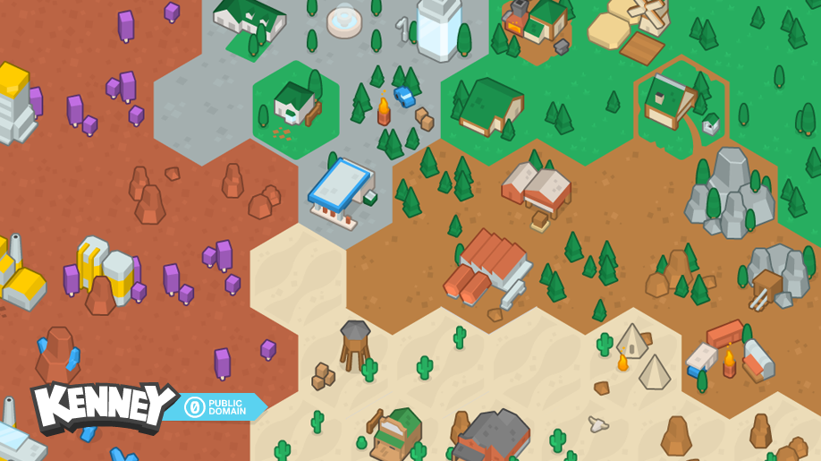

# 01. A tile editor and a grid that wouldn't sit still (April to May 2020)

*Dates: 12 April to 29 May 2020*

Hexa did not start as a strategy game. The first commit in the repository, on 12 April 2020, was a small pygame program that drew a hex grid and let you paint tiles on it. It was a map editor, and it is still in the repository today as `Hex.py`, the legacy editor at the root of the project.

## What was built, and why

The first weeks were about getting the grid right. Hexagons are fiddly: the tiles had to meet cleanly, the mouse had to pick the right hex, and the picture had to match the shape. The commits from those weeks show the work:

- **Tile art.** On 14 April the Kenney hexagon pack came in (CC0 tiles, objects and terrain). From then on the game was drawn with these tiles, not with flat colours. This is the art style every later chapter uses.
- **Gaps and hitboxes.** Early tiles left thin gaps between them, and clicks landed on the wrong hex. Several commits fixed both.
- **Tile selector.** The tile picker sizes itself from the texture of each tile.
- **Map layers and water.** A layer button, rivers and water tiles arrived in late April.
- **Saving and loading maps.** In late May the editor gained XML save and load, and then the ability to load a map back from XML. The XML map files in the repository belong to this editor.

kioba, the project's co-developer, sent the first pull requests to the project in April 2020 (merged as `#1` to `#4`). They dealt with the same grid problems: the gaps between tiles and the hexagon hitbox. That was the first time the project had a second person's hands on it.

*The Kenney hexagon pack sample. This is the art the editor was drawn with. It is not a screenshot of the 2020 editor itself, which is not preserved as an image.*

## What we learned

The grid was the hard part, and the trouble was almost all in small numbers: a few pixels of gap, a hitbox off by half a hex. The lesson that carried forward was to check the geometry on screen, not only in the head.

Nobody was building a game yet. That came more than six years later, in the same repository, once the tiles had been worked out.
