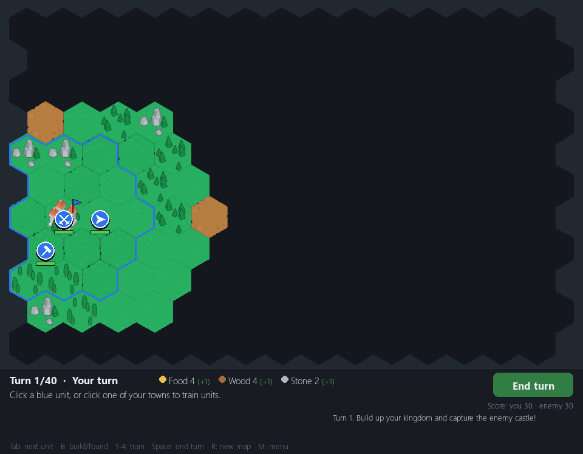

# 02. The first playable match: Conquest (9 November 2026)

*Dates: 9 November 2026. Commits "Add a playable turn-based strategy game" and "Add towns and economy".*

The editor could paint a map, but it could not play one. On 9 November the project grew its first game: **Conquest**, a small medieval match on a hex map against one rival kingdom.

## What was built, and why

The goal was a game a player could finish in one sitting, so the rules are small. You move units, train them in towns, and win by moving a soldier onto the enemy castle. If nobody gets there by turn 40, the higher score wins.

The first commit added the core: the map generator, the world state, the rules, the AI and the renderer, with tests. The second commit added the economy:

- **Food, wood and stone** come in every turn. A castle, towns, farms, lumber camps and mines produce them.
- **Towns own the land within two hexes**, so capturing a town takes its buildings too.
- **Units** are scouts, soldiers, workers and settlers. Each has its own cost, moves and combat numbers, and they are all in `hexa/rules.py`.
- **The computer** builds its own economy, gathers three soldiers, then attacks together.

All the numbers live in one rules file, and the README tables are kept in step with it. The rule is still there in the README and the code.

*Conquest at turn 1. Blue units stand in the player's territory, the status bar shows food, wood and stone, and the score is shown against the enemy.*

## What we learned

Conquest was built as the proving ground for what came next. It was the first place where the "check, then act" pattern was used for player actions (`train_check` and `train`, `build_check` and `build`, and so on), so the buttons and the hover hints always agree with the rules. That pattern carried straight into the later modes.

There is no record in the history of a change of plan here. The mode was small, and it stayed small on purpose: it is the side game beside the main campaign.
