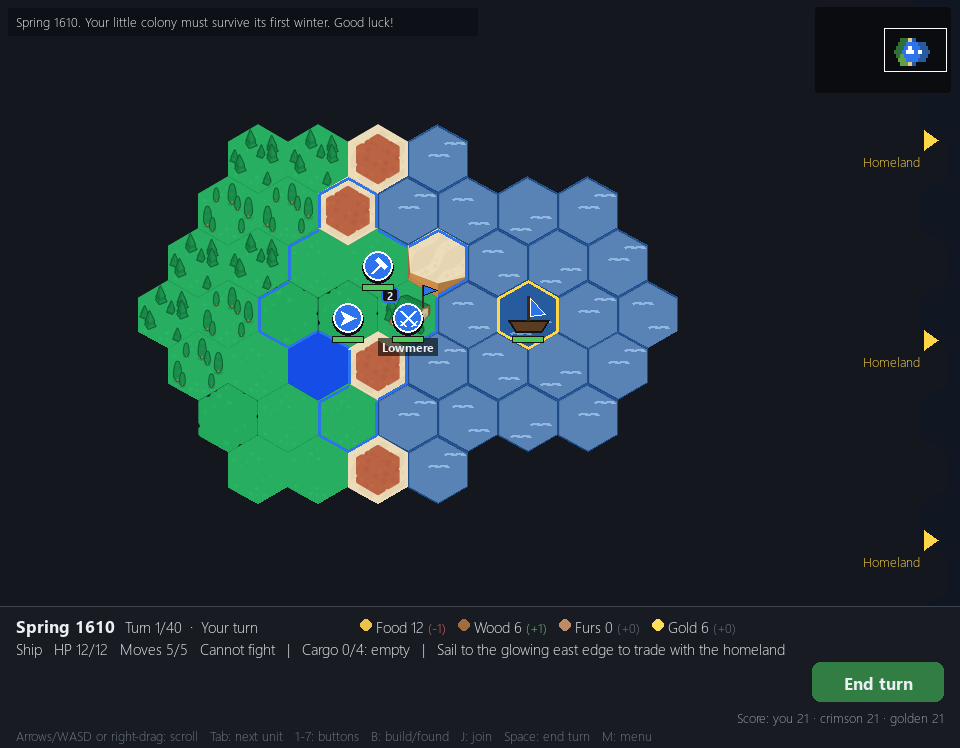
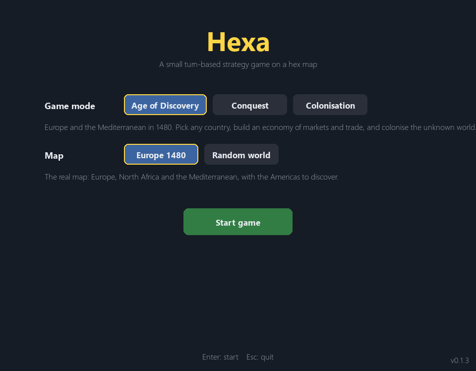

# 03. Colonisation and the start menu (9 November 2026)

*Dates: 9 November 2026. Commit "Add colonisation and survival mode with a start menu".*

The same day, the project grew a second side mode and a front door. **Colonisation** is a survival game on a big unknown continent. You land colonists, survive the winters, deal with native tribes, trade with your homeland and try to out-grow two rival companies. Until now the game started straight into Conquest. Now there was a **start menu** to choose the mode.

## What was built, and why

Colonisation was a different kind of game, so it got its own world, rules, AI and app, in `hexa/colony/`. It reuses the Conquest renderer and the same hex grid, so the two modes look like one game.

The menu chooses:

- **Game mode:** Conquest or Colonisation (and, from the next chapter, Age of Discovery).
- **Start:** by sea (your ship lands the colonists) or on land.
- **Goal:** survive, independence, or an endless game.

The command line also takes the same choices (`--mode colony --start land --goal independence`), so a player can skip the menu once they know what they want.

Colonisation's core loop is the ship. You raise colonists at a homeland port, board a caravel, sail into the fog, and unload onto a free coast. Then you press B to found a colony.

*Colonisation in spring 1610. The colony's town and two stacks sit on the green coast, a ship is in the bay, and the homeland edges are on the right.*

*The start menu in the v0.1.3 build (it was first added with Colonisation, on 9 November). The version number shows in the corner.*

## What we learned

The start menu was added because a second mode needed a place to be chosen from. The choice of the start (sea or land) also moved the game's first decision out of the map and into the menu, so a new player sees the options before the map. This became the pattern for the later modes: every mode is picked in the same place and every mode has a command line.
