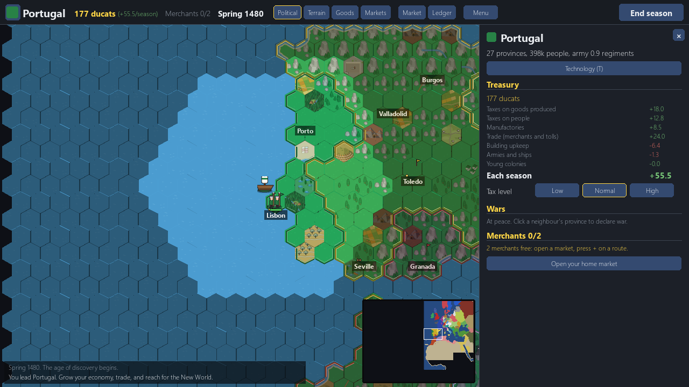
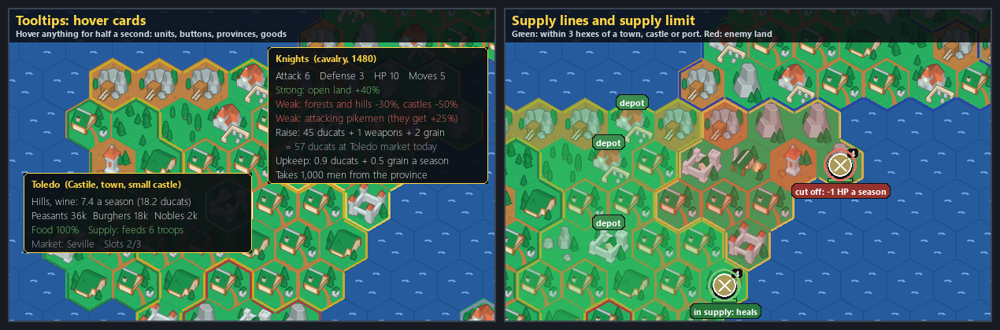

# 04. Age of Discovery begins: Europe in 1480 (10 November 2026)

*Dates: 10 November 2026. Commit "Add Age of Discovery campaign mode".*

This is the turning point. Conquest and Colonisation were side games. On 10 November the project started its main game, **Age of Discovery**: a Europa Universalis-style campaign on the real map of Europe, North Africa and the Mediterranean, starting in spring 1480.

## What was built, and why

The idea was simple to state: pick any real country, run its economy, trade with the neighbours, fight them when it pays, and sail into the unknown. The first campaign commit was large (9 files and about 5,600 lines), because the whole frame came in at once:

- **The map.** A real 1480 map, drawn from coastline data onto the hex grid. Every land hex is a province, and each province belongs to a country (about fifty of them).
- **Time.** One turn is one season, from spring 1480 to 1650.
- **The economy.** Goods are raw, luxury or made in town. Provinces produce them, markets trade them, and prices move with supply and demand. Each country has taxes on goods and on people, manufactories, and merchants who carry goods along routes.
- **War.** Armies move as stacks of units, and each stack has a size limit by era. Stacks need supply: wagons, depots and foraging decide how far an army can go from home.
- **The map view.** Political, terrain, goods and market modes, a country panel, a ledger, and hover cards that explain each thing you point at.

The first build already had the economy and the war, not just the map.

*Portugal in spring 1480. The country panel shows the treasury, the season's income, the tax level and the merchants. The map shows Portuguese land, the Spanish neighbours and the cities of the time.*

*An early mockup of the supply and tooltip ideas. The supply rules you see on the map today grew out of ideas like this.*

## What we learned

The first playtest, on 11 November, was blunt. The economy had no pressure and no sink. An idle Portugal reached about 9,000 ducats by 1517 with nothing to spend them on, and the best money lever, merchants, was hidden in a grey counter that nobody was told about. One wine route alone was worth more than the whole income, and in forty seasons the player used none of the merchants.

The fix list that followed is in [08](08-playtest-and-the-crash-fixes.md), and the economy is still on the list for the balance pass in [11](11-whats-next.md). The lesson: a rich economy with no choices is still a dead one. The playtest report (in `docs/reports/`) is the record of it.
