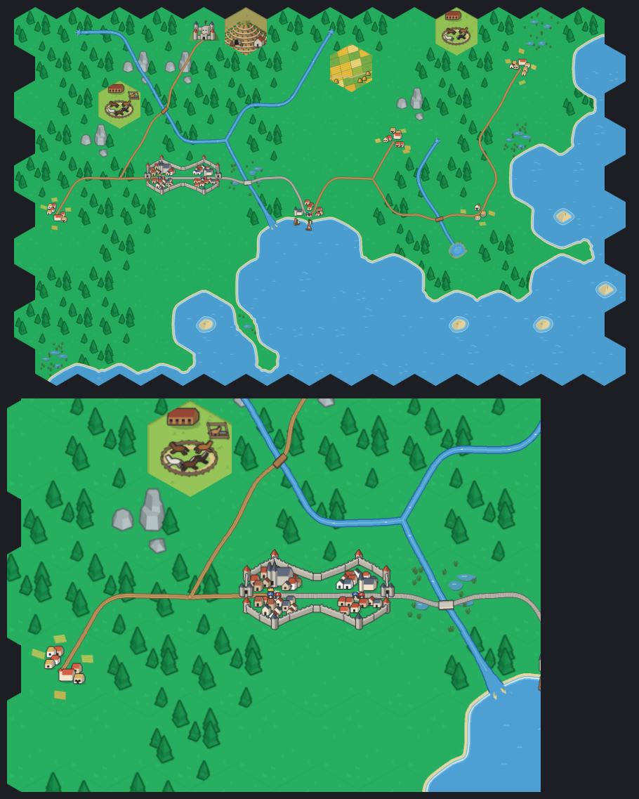
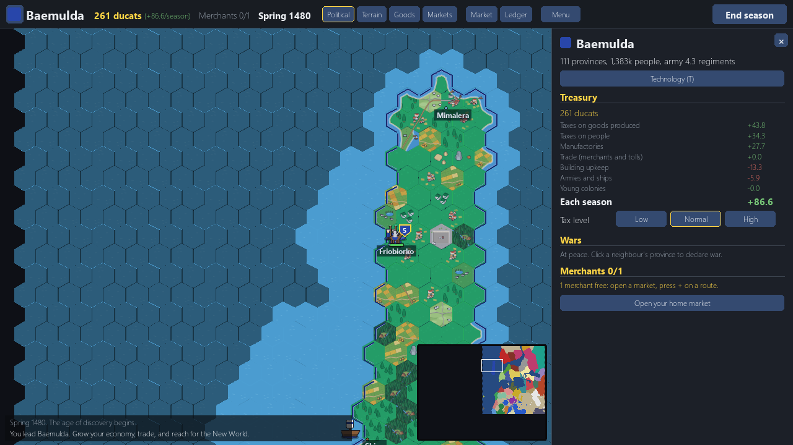

# 05. A finer map, terrain by wave function collapse, and random worlds (10 November 2026)

*Dates: 10 November 2026. Commit "Age of Discovery: finer map, wave function collapse terrain, random worlds, new art".*

The first campaign map was true to the coastline but flat inside: the terrain was blocky and every game looked the same. The next commit changed three things at once.

## What was built, and why

- **A finer map.** The campaign's hex scale was doubled (the geography module uses `SCALE = 2`), so coasts and rivers got more detail. The distances in the data files scale with it.
- **Terrain by wave function collapse.** Each hex starts with a set of possible terrains and a prior from latitude, mountains, deserts, marsh and rivers. Neighbours must fit together under a list of forbidden pairs, and the terrain collapses hex by hex until the whole map is filled. The result looks grown rather than painted, and it changes with the seed.
- **Random worlds.** A new map type builds an invented world each game: new countries with new names, an inland sea, and an unknown New World. `--seed` replays the same world. The start menu offers the random world beside the real 1480 map.

The new art came in the same commit, in the Kenney style, so the bigger map did not look like a different game.

*Terrain grown by wave function collapse, from the design sheet. Forests, rivers and roads all came from the rules, not from hand placement.*

*A random world at the start, with an invented country, Baemulda, on its coast. Every game gets a new set of countries and borders.*

## What we learned

The random world exposed a loose end that is still open. The roadmap asks whether a random world's start country should be chosen by the player or given at random. The roadmap lists it under M5 (world and naming fixes), along with the number of starting towns, which is too high on the real map too.
