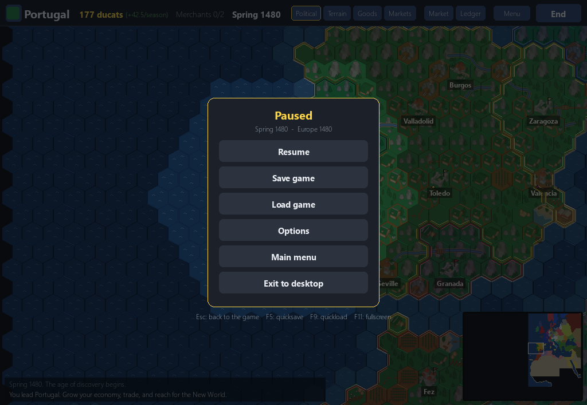
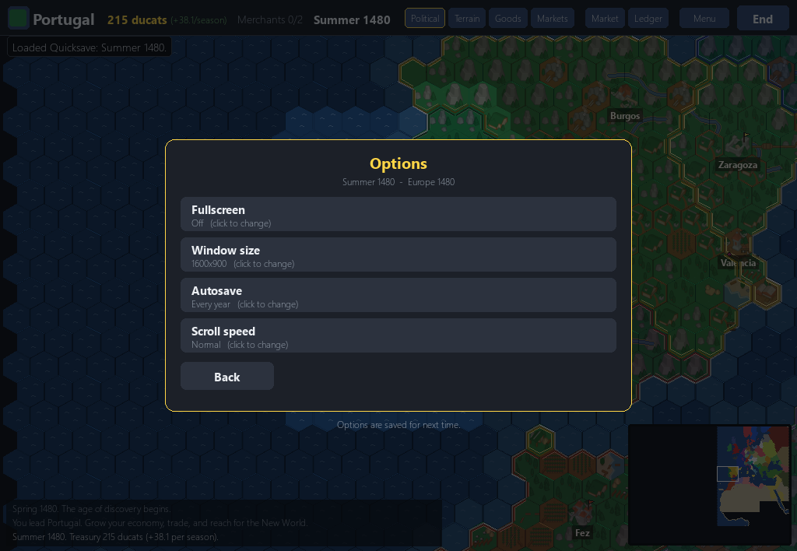
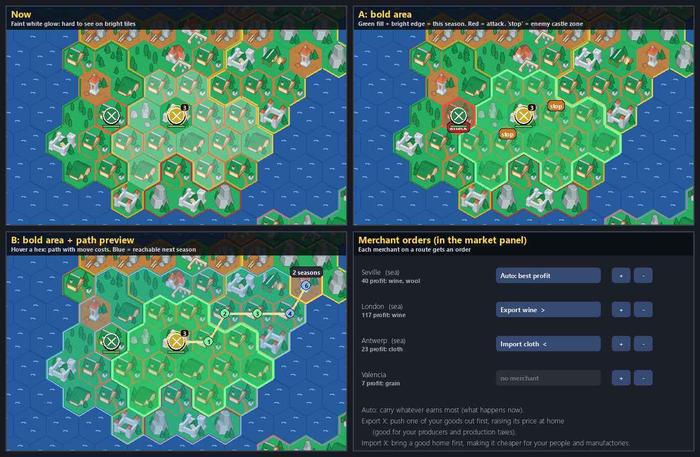

# 06. The in-game menu, saves, options, and walking moves (10 November 2026)

*Dates: 10 November 2026. Commit "Age of Discovery: in-game menu, save/load, options, fullscreen; walking moves".*

A long campaign needs a way to stop, save and come back. On the same day as the campaign's first map, the project got a proper in-game menu, saves, options, and a new way to move armies.

## What was built, and why

- **The Esc menu.** Resume, Save game, Load game, Options, Main menu and Exit. A hint strip at the bottom names the keys: Esc to return, F5 to quicksave, F9 to quickload, F11 for fullscreen.
- **Saves.** Eight save slots, a quicksave on F5 and a quickload on F9, and an autosave that can run once a year (an option). A save is a small JSON header followed by the world's state. It is checked on load, so an old or broken save cannot quietly start a different game (that rule was hardened later, in [08](08-playtest-and-the-crash-fixes.md)).
- **Options.** Fullscreen, three window sizes (1280x720 by default, 1600x900 and 1920x1080), autosave on or off, and the scroll speed. The settings file lives in the player's own folder, and the `HEXA_HOME` variable moves it for tests.
- **Walking moves.** A selected stack shows where it can go this season (bright green), where it can go next season (blue), and what it can attack (red). Hovering a hex shows the path, the cost of each step and how many seasons the walk takes. A stack moves at the speed of its slowest unit.

*The Esc menu over the game. The map keeps running behind it, and the hints under the menu name the keys.*

*The options page. Window size and fullscreen are changed here and saved at once.*

*A design sheet for walking moves. The reach of this season, the next season and the attack options show in three colours, and the path shows the cost of each step.*

## What we learned

The first playtest of sailing found a bug: a ship ordered into the black fog jumped straight to the target instead of sailing the route. Every unit had the same problem. Now a move follows its route one hex at a time, uncovering the map as it goes, with a short slide animation so you can see where it went.

Walking moves also needed each step to show its cost, or a player could not plan a walk across several seasons. The screen shows the numbers the rules already use, rather than a second set of numbers for the display.

Saves had a rule from the start that the game would never start a different game silently. That rule was tested in November, when a bad save could still crash a Continue. Those crashes came up in [08](08-playtest-and-the-crash-fixes.md).
