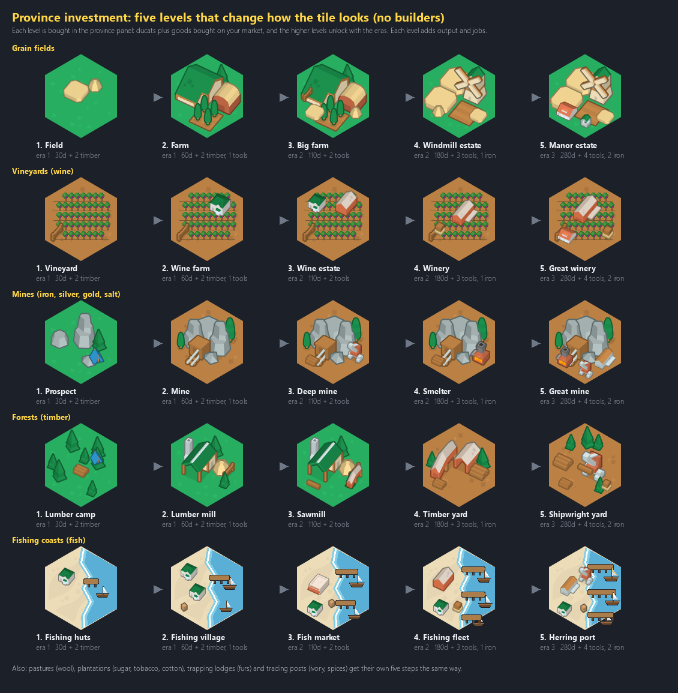
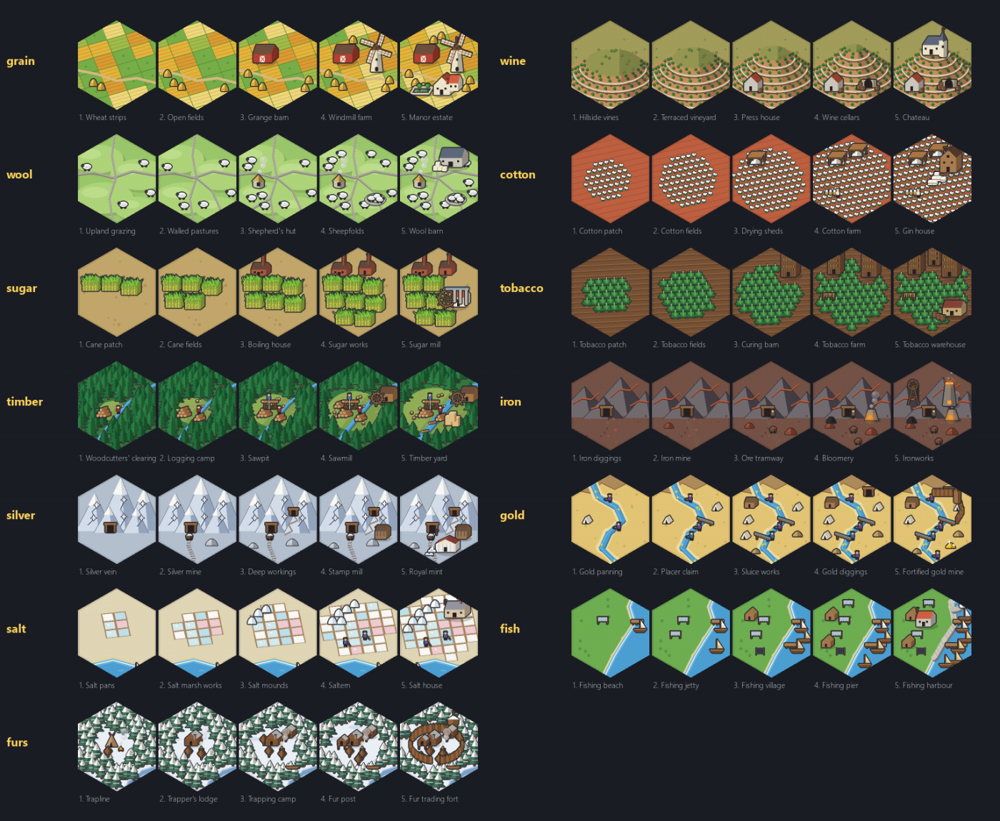
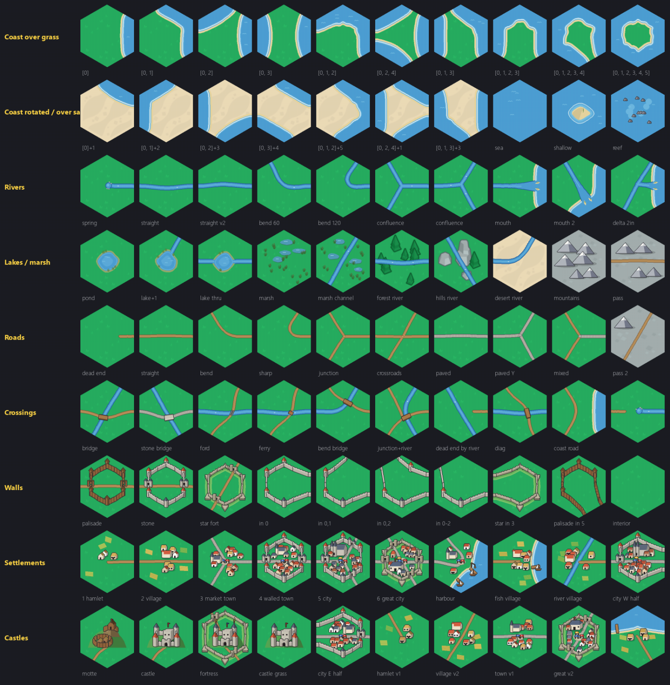
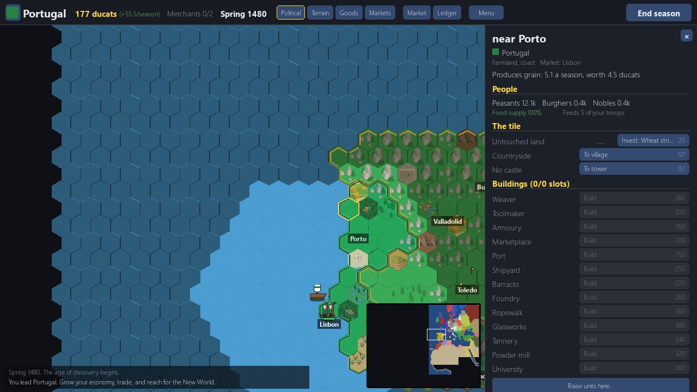

# 07. Province investment, new goods and the edge-matched tileset (11 November 2026)

*Dates: 11 November 2026. Commit "Age of Discovery: province investment, new goods, goods art, WFC tileset; review fixes".*

The campaign had money and armies, but the land itself did not change when you spent. This chapter fixed that: a province could now be improved, the goods it made got their own art, and the terrain tiles were rebuilt so that they join properly.

## What was built, and why

- **Province investment.** A province's goods tile can be improved up to five levels. Each level costs ducats and some of the province's own goods. The tile's art changes with the level, so you see the investment on the map.
- **New goods.** The game now has 32 goods across raw, luxury, money and made-in-town groups. Each province makes one raw good.
- **Goods art.** Every good has a tile of its own (grain, wine, salt, silver and the rest), drawn in the same Kenney style and checked against the other goods.
- **The edge-matched tileset.** The terrain tiles were built on a set of edge sockets: a coast edge only meets a coast edge, a road only meets a road. This is what lets coasts, rivers, roads, bridges, walls, towns and castles join cleanly. The rules are in `wfctiles.py`.

The commit was large (13 files, about 5,400 lines), and its message ends with "review fixes".

*Province investment, from the design sheet. The investment button shows the next level and the cost beside it.*

*The goods art, from the design sheet. Every good has its own tile, so a market map reads at a glance.*

*The edge-matched tileset. Each tile's edges are sockets, so a tile can only sit next to tiles whose edges match.*

*The province panel in the game. The Invest row and its cost show on the tile, and the buildings below it list what can be built.*

## What we learned

The playtest of 11 November found two small things in exactly this area, and they are worth naming because they are the kind of thing players notice first. The Invest button's label ran over its cost, and the log said "now a open fields" because every article was "a". Both were fixed and now have tests in `tests/test_playtest.py`.

The playtest also called the investment the right size of decision: cheap, instant, and visible on the tile. The same report flagged that money had no sink at all, which is why the economy is on the balance list.
