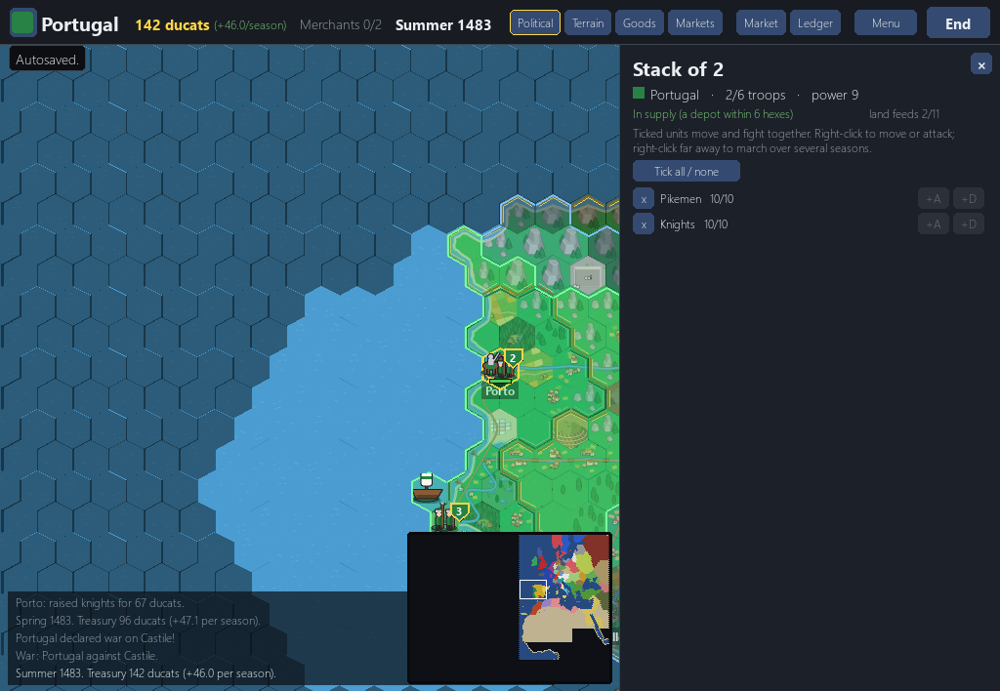

# 08. The playtest and the crash fixes (11 November 2026)

*Dates: 11 November 2026. Commits from "Treat non-object JSON in save headers" to "Bump version to 0.1.1", released as v0.1.1.*

By 11 November the campaign had a lot of systems and very few people had played it. Two things happened that day: the designer ran a scripted playtest of the whole campaign, and kioba filed a list of issues. Most of the work in this chapter answers one of the two.

## What was built, and why

**Kioba's crash and save fixes (v0.1.1).** The issues were mostly about things that should never crash a game: a failed save, a corrupt save, a settings file that could not be written, a bad `--nation` name, a pause-menu click before the screen was drawn. Each one got its own commit, its own pull request and a test. The triage counted 44 issues on the project. Seven of them, #5 to #11, were the crash and save-safety set, and they were closed as fixed.

**The playtest.** The designer played the campaign headless, through the same event handler the window uses: forty seasons of economy, a war against a neighbour, a colony expedition, save and load, the Esc menu, a random world, and an idle run to 1650. The result is in `docs/reports/playtest-2026-11-11.md`. It lists the things that work, the bugs and the confusing parts, and it ranks ideas by impact.

The bugs it found and that got fixed were small and specific. A freshly raised unit had no moves, so it froze its whole stack. Provinces flipped owner while an army stood in them. The game-over banner ran off the screen. Each now has a test in `tests/test_playtest.py`.

*The stack that froze. A unit raised this season had no moves, and the stack moves at its slowest unit, so the whole stack could only reach one hex. The toast said "They cannot get there" with no reason. It is fixed now.*

## What we learned

The verdict in the playtest was honest: "Is it fun yet? Not yet." The first season was pleasant. From about season ten the loop became "invest in a tile, end season", and there was no goal on the first screen that said how the game was won. The report's best ideas were simple ones: say why a button is disabled, name every province, show the tax trade-off, and keep the merchants visible.

Those ideas went into the plan, and some of them are still open. They are the reason the roadmap puts balance and polish near the front, and they are why the next chapters spend more time on what the player can see than on new systems.
