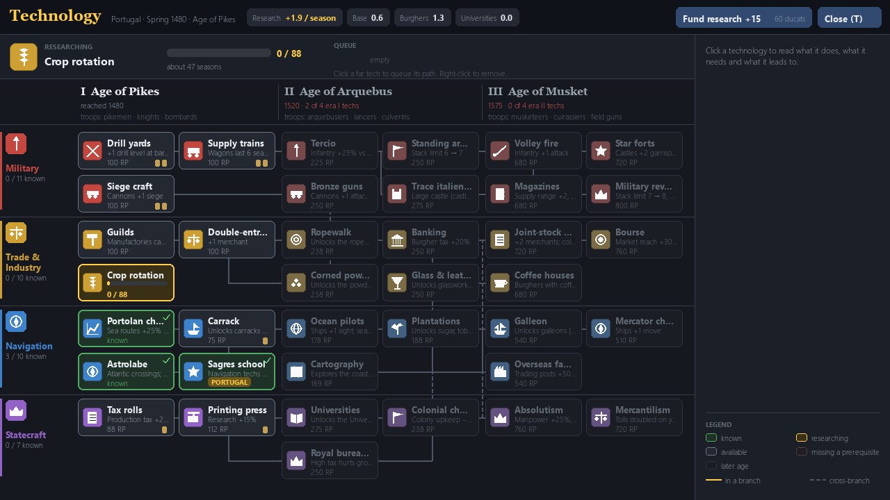
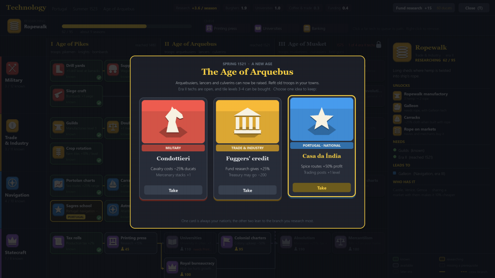
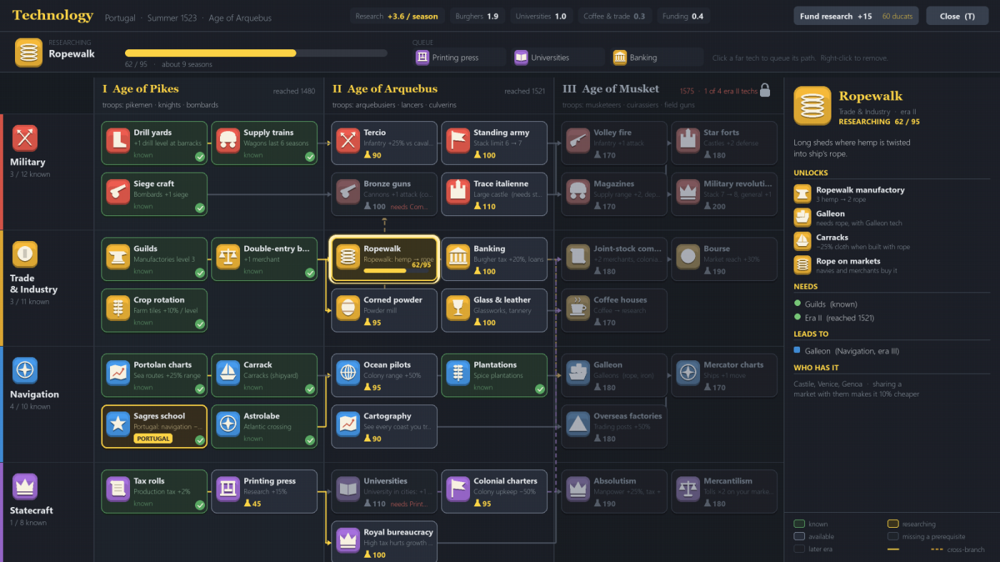

# 09. The tech tree (11 November 2026, v0.1.2)

*Dates: 11 November 2026. Commit "Age of Discovery: tech tree (4 branches x 3 eras), idea cards, tech screen", released as v0.1.2.*

Research in the campaign used to be a single bar. The tech tree replaced it with a real tree: four branches, three eras, and a screen you open with T.

## What was built, and why

The design came first, and it was approved before any code was written. The designer looked at three mockups for the tech screen (A, B and C) and picked A for the layout, with the idea cards from C. The approved design lists the techs, their effects and their prerequisites, and it says what the era gate is.

What shipped:

- **37 techs** in four branches (Military, Trade and Industry, Navigation, Statecraft) across three eras. Every country also starts with a **national tech**, such as Portugal's Sagres school.
- **Era gates.** Era II opens from 1520 once a country knows four era I techs. Era III opens from 1575 after four era II techs.
- **Research points** come from a base, from burghers, from universities and from coffee houses. A country can also fund research with ducats (60 ducats for 15 points, once a year). A tech is cheaper when the countries you trade with already know it.
- **A queue.** Click a far tech to queue its path. Right-click removes it.
- **Idea cards.** At each new era the country picks one of three cards. One card is always its own nation's.
- **The AI** researches, funds research and picks idea cards by its situation.

Troop types still come with the eras. Military techs give tactics, drill, siege, castles, supply and stack size instead, as the approved design said.

*The tech screen in the game (T). Each row is a branch, each column an era. The top bar shows research per season, and the panel on the right explains the selected tech.*

*The approved design for the idea cards when a new era opens. One card is the nation's own.*

*The approved tech tree layout (mockup C in the design notes). The game follows its branches and era columns.*

## What we learned

The first build researched about four times too fast: a country raced through the tree. Three changes brought it down. Funding research works once a year instead of every season, unspent points stop piling up when nothing is being researched, and tech costs are scaled up by era. The tests now check the pace.

The approved design and the build spec also did not agree on one number: the build spec said 38 techs, the design tables listed 37. The roadmap asked for the number to be checked before the build was finished. The shipped tree has 37 techs, matching the design tables.

The playtest also asked a fair question about the fund-research button. It said "+15 for 60 ducats" with no sign of whether that was good. The tech screen now shows research per season beside the button. The pace itself is a balance question for [11](11-whats-next.md): the targets are 2 to 6 points a season for a mid-sized country, one tech every three to ten years, and about 70% of the tree by 1650.
