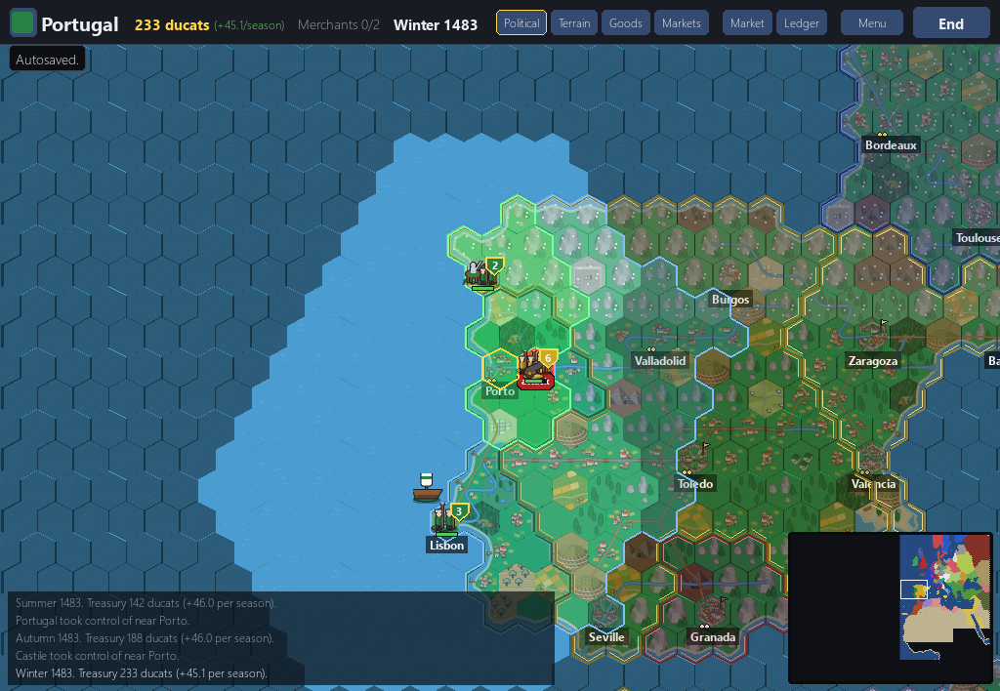

# 10. War and peace rules, kioba's milestone (11 November 2026, v0.1.3)

*Dates: 11 November 2026. Merges from the war and logistics fixes, released as v0.1.3.*

With the tech tree in, kioba took on the war and logistics rules. The issues were about what armies were allowed to do, and several of them were real bugs that had been in the game since the campaign arrived.

## What was built, and why

Seven fixes, each with its own pull request and a test:

- **Cannons** no longer bombard their own stack when it stands on an enemy castle hex (#12).
- **Only the owner** can forage a stack, so a player cannot freeze an enemy army by foraging it (#13).
- **Peace** only sends home armies that stand in the other party's land. Before this, peace moved every army of both sides wherever it stood, even one fighting a third country (#14).
- **White peace** keeps provinces held by a third country in another war (#15).
- **Boarding** picks a ship with room for the whole group (#20). Two ships on one hex could be overfilled.
- **Cut-off computer armies** forage at the end of the season, instead of only losing strength (#21).
- **Battle reports** count the strength lost in that fight, not all the strength missing from the stack (#28).

The triage showed each of these bugs still present on the main branch when it was checked. Each fix was merged, with tests, and the milestone shipped as v0.1.3.

*The war view before these fixes, from the 11 November playtest. Provinces changed owner under a stack, and the log did not say who won the battle.*

## What we learned

The peace bug is the clearest example in the project of a rule that worked on paper and failed in play. The peace code moved every army in any foreign province, so a peace with one neighbour could take an army back from a front it was fighting on with a third. It was a rule about land, written without the question "whose land is this?". The fix checks the land owner before moving an army, and it has a test for that case.

The triage also gave us a number to watch. Of 44 issues, seven were fixed in the crash set and seven more had open pull requests at the time, so the project had a clear view of what was left.
