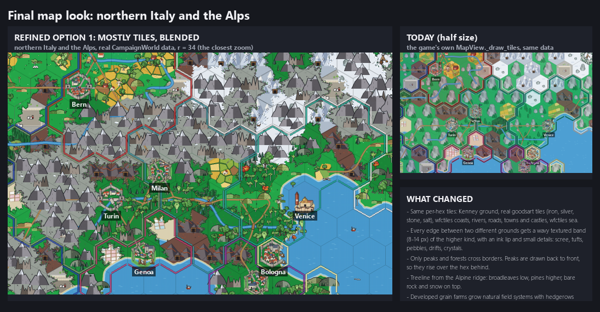
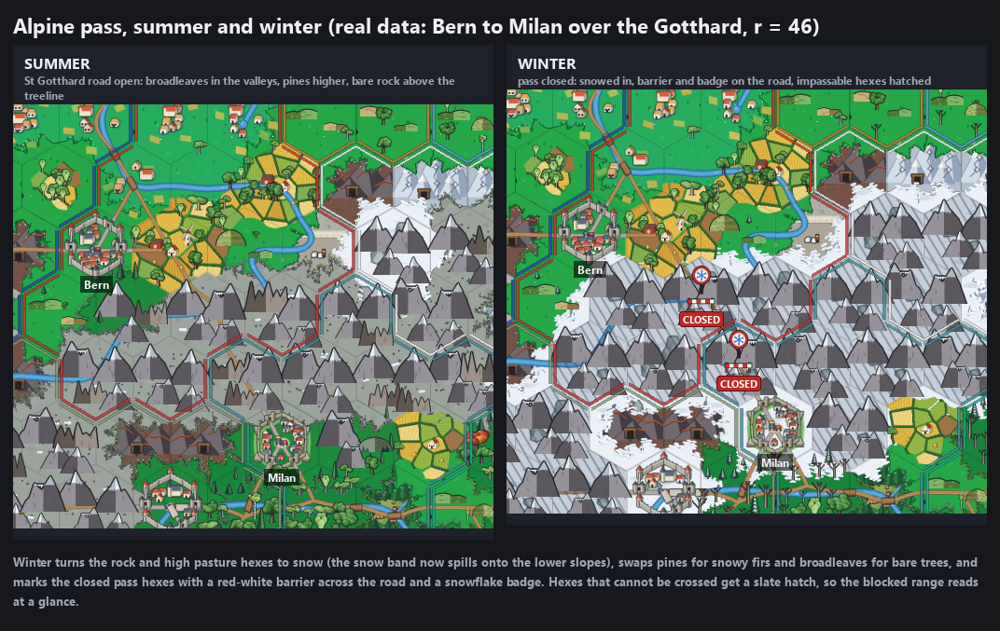
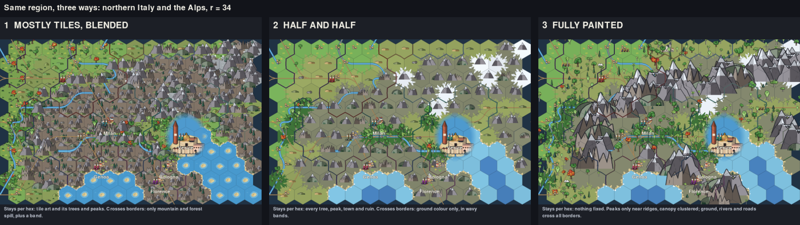
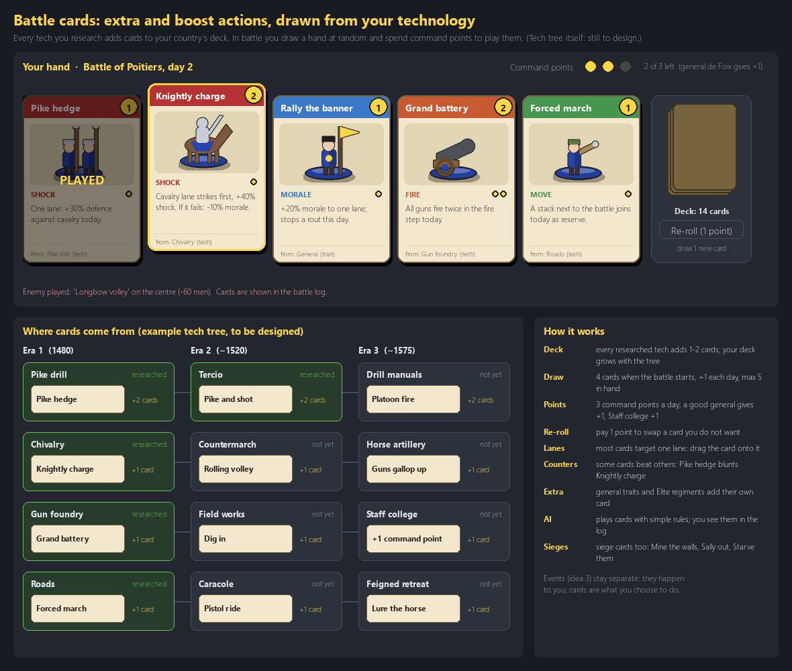

# 11. What's next: the map look, battles, balance, events and Steam

*Dates: planned from 11 November 2026. Source: `docs/roadmap/roadmap.md` and `docs/roadmap/long-term-roadmap.md`.*

The project is at v0.1.3 as this diary is written. The tech tree and the war rules are in, and the next milestones are planned. The roadmap is the source of truth; this is a short tour of it, in the order the work is planned.

## M3: the map look and the UI polish (next up)

The map is still the most visible weakness. The tiles are good, but every hex edge is hard, and the zoom stops too soon. The approved direction is "mostly tiles, blended": a crisp transition band where two different grounds meet, objects that rise over the hex behind them instead of being cut at the top, and a closer zoom. The environment will change with the game: a town built in a forest clears the trees, development spreads fields, and winter brings frost.

Winter also has a rule, not only a look. Mountain passes cannot be crossed in winter, and they are painted snowed in.

*The refined map look on real campaign data, with the current map in the corner for comparison. This is the mockup the user is asked to approve before the M3 build starts.*

*A winter mockup. The pass is closed in winter, and the mark on the hex says so.*

*The three options for the map look. The first, "mostly tiles, blended", was chosen on 11 November.*

The UI polish round is part of M3 too: one button style, tidier panels, clearer typography, and fewer clicks for common tasks.

## M2: the battle system

Contested hexes will be fought on the shared tile, with three lanes and cards. The cards come from researched techs and from generals, and every deck starts with the era I cards. Command points set the pace. A quick auto-resolve will sit beside it for small fights and for AI against AI.

M2 needs M1 (the tech tree is done), and it has to match the approved battle mockups.

*A battle card design from the approved battle mockups. The battle design is not built yet.*

## M4: balance and playtest

Once the systems are finished, a full game from 1480 to 1650 must feel right. The targets are in the roadmap: a steady research pace, a tech every few years, no country stuck at zero research, and an AI that reaches era III in most runs. The numbers live in data files so they can be tuned without code changes.

## M5: world and naming fixes

The loose ends that make the map feel unfinished: fewer starting towns, better province names instead of "near Porto", coastlines that follow the land, small towns on the map, and a sensible start country in a random world.

## Events and characters (Phase 3)

Interactive event pop-ups with choices, named characters with traits, and historical event chains (for example the Treaty of Tordesillas). These come after diplomacy and religion in the long-term plan.

## 1.0 and Steam

The final goal, decided on 11 November, is to publish Hexa on Steam. The long-term roadmap ends in a Steam release: a packaged build, save versioning, a store page, a demo or a Next Fest entry, and an Early Access or full release. Every phase works toward a game that meets Steam's bar.

## What we learned

The approach did not change in this diary, and that was on purpose. Every big feature is mocked up and approved before it is built, and the work is split into chunks that are built, tested and shown together. The one change in plan so far is the order: the polish round (M3) moved ahead of the battle system at the user's choice.
